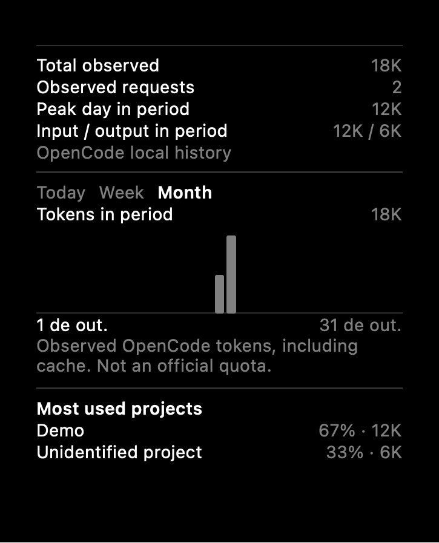

# Codenotch Dev — histórico e painéis

Atualização de 17/10/2026. Desenvolvimento incremental sobre a versão local, preservando as mudanças já existentes.

## Diagnóstico e correção dos períodos

O seletor de custos/projetos era incluído apenas quando havia linhas. Ao escolher Today em um dia sem atividade, o modelo ficava waiting com zero linhas; a geometria removia a seção inteira, incluindo Week e Month. A seção agora reserva uma linha vazia quando a fonte existe, mantendo o seletor. Resultados assíncronos de um período anterior deixam de substituir a seleção atual.

Novos históricos usam um bloco de altura fixa, separadores do tema e o gráfico de barras já usado no Codex. Today, Week e Month permanecem visíveis inclusive sem dados. Month é o padrão; a seleção fica salva por provedor/modelo. A seleção de custos é independente por conta. Meses e semanas usam o calendário local; dados de um dia anterior não são apresentados como Today quando a fonte fica offline.

## Fontes e métricas

| Fonte | Dados disponíveis | Limite conhecido |
| --- | --- | --- |
| NVIDIA/OpenCode | Total observado, contagem de respostas com tokens, entrada/saída quando presentes, maior hora/dia do período, série por hora/dia e projeto da sessão | Não equivale à franquia oficial nem ao lifetime absoluto da conta. Cache/raciocínio seguem o total explícito do OpenCode, evitando duplicação. |
| Copilot | Plano, Chat requests, Completions, premium e outras cotas devolvidas pelo adaptador existente | Fonte atual não fornece eventos datados, tokens ou atribuição de projetos. O painel informa indisponibilidade; não inventa distribuição. |
| Ollama | Respostas nativas completas observadas pelo relay opcional: tokens de entrada/saída, requisições, velocidade e duração de geração; TTFT quando observado no streaming | Não recupera chamadas que contornaram o relay. Raciocínio já incluído na saída não é somado novamente; divisão não fornecida fica indisponível. |
| LM Studio | Ledger e logs já existentes, preservados por runtime | Origem de projeto não é deduzida de prompts. |

OpenCode é consultado em modo de leitura. Diretório de sessão é usado somente quando existe no schema, exibindo apenas o nome final. Sessões sem essa informação entram como projeto não identificado. Os três maiores projetos aparecem individualmente, com os demais em Outros; as participações usam o total do mesmo período.

O Ollama reutiliza `OllamaThinkingStream`, o relay de loopback e `LocalTokenLedger`. Cada modelo/variante mantém seus próprios registros. Modelos observados continuam consultáveis depois de descarregados, sem carregar pesos. Históricos do Ollama e LM Studio não substituem um ao outro. O ledger guarda contagens por hora/dia por até 60 dias nos ajustes locais do Dev para sobreviver ao relançamento. Não armazena prompts, respostas nem raciocínio textual. Captura permanece opcional e exige clientes usando o relay existente; nenhuma configuração de cliente foi alterada automaticamente.

## Componentes reutilizados

- `LimitWindowRow`, `SplitRow`, `Palette`, `Typography` e `Design`.
- `CodexDailyUsageChart` e os cálculos de geometria do notch.
- `OpenCodeSchema`/`SQLiteStore`, os adaptadores existentes e `UsageArchive`.
- `LocalTokenLedger`, `OllamaThinkingStream`, `OllamaRelayServer` e `NotchFleet`.

Não foi criado um segundo coletor, uma API paga ou uma dependência nova. Copilot preserva suas categorias, percentuais e barras. Longest chat e streaks não foram inventados a partir de datas incompletas.

## Validação

Em 17/10/2026, `xcodebuild test` executou 2.159 testes, 6 ignorados e zero falhas. Os ignorados exigem integração real/opção explícita; não foram usados tokens de inferência para testes. Foram cobertos períodos vazios, calendário/DST, projetos reais do schema de fixture, persistência por modelo, métricas parciais e separação dos runtimes. A geometria foi verificada nos três tamanhos e nas quatro bordas, incluindo cinco modelos e métricas completas.

Prévias nativas SwiftUI dos três períodos e cartões NVIDIA/Copilot foram inspecionadas; usam dados sintéticos, não capturas das contas do proprietário. A margem do painel agora compartilha o espaço disponível nas bordas verticais e mantém os cartões dentro da área visível. O aplicativo original foi preservado. Não houve validação de APIs reais de conta nem inferência local nesta etapa.

## Atualizações e aplicativo original

O Dev funciona sozinho. O atualizador oficial está limitado ao identificador do aplicativo original; manter esse aplicativo instalado não atualiza o Dev. As personalizações precisam acompanhar builds próprios deste fork. Nenhum aplicativo antigo foi removido nesta tarefa.

## Build instalado

Codenotch Dev 1.22.1, build 25, instalado em `/Applications/Codenotch Dev.app`. Build Release aprovado; assinatura ad hoc com hardened runtime e verificação `codesign --verify --deep --strict` aprovadas. A interface abriu as notas da versão 1.22.1. O Dev continua independente e sem atualização automática pelo canal oficial.

Prévia SwiftUI de teste, com valores sintéticos, não captura de conta real.
